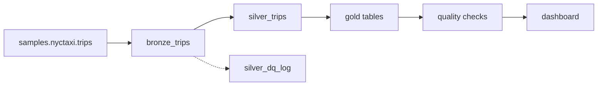

# NYC Taxi Lakehouse on Databricks

I built this to learn the Databricks lakehouse workflow end to end: loading raw data, cleaning it with rules I can audit, building analysis tables, checking the results automatically, running everything as a scheduled job, and presenting it in a dashboard. The data is two months of NYC taxi trips (January–February 2016) from the Databricks sample datasets.

Built with Databricks, PySpark, Spark SQL, Delta Lake, Unity Catalog, Databricks Asset Bundles, and AI/BI Dashboards.


## How it works

The pipeline follows the bronze, silver, gold pattern:



- **Bronze** (`01_bronze.py`) copies the source data unchanged and records when it was loaded, so everything downstream can always be rebuilt from it.
- **Silver** (`02_silver.py`) removes invalid trips using six named rules: missing values, zero or negative distance or fare, dropoff before pickup, trips over 3 hours, and trips over 100 miles. Every run logs how many rows each rule caught to `silver_dq_log`, so nothing disappears silently. It also adds trip duration, speed, fare per mile, and time-of-day columns.
- **Gold** (`03_gold.py`) builds five analysis tables: demand by hour, a daily trend with a 7-day rolling average, top pickup ZIP codes, top routes, and fare per mile by trip length.
- **Quality checks** (`04_quality_checks.py`) run last and fail the job if anything is wrong, for example a negative fare in the cleaned data, or gold tables that don't account for every trip.

The whole pipeline is defined in `databricks.yml` and deployed as a job with Databricks Asset Bundles. Each notebook runs as its own task on serverless compute, and a full run takes about two minutes.


## What I found

- **The data was cleaner than I expected.** Only 118 of 21,932 trips (0.54%) failed the cleaning rules, mostly zero-distance trips (76) and trips over three hours (33).
- **The pipeline caught a blizzard.** Trips averaged 364 a day, but January 23, 2016 had only 78. That was the day of the Winter Storm Jonas blizzard, when New York City banned travel.
- **Demand peaks in the evening, not the morning.** The busiest hour is 6 PM on both weekdays and weekends. Weekend totals look much lower, but that's mostly because there are fewer weekend days in the period: per day, the 6 PM peak is about 23 trips on weekends and 25 on weekdays.
- **Traffic is slowest late morning and mid-afternoon,** averaging 10.5 mph at 11 AM and 3 PM.
- **The busiest pickup areas** are ZIP codes 10001, 10003, and 10011 (around Penn Station, Union Square, and Chelsea).
- **Short trips cost about three times more per mile.** Trips under a mile average $9.39 per mile, while trips over ten miles average $3.04. The fixed starting charge weighs more on short trips, and short trips spend more of their time stuck in slow traffic.

The full results are saved as CSV files in [`results/`](results).

## Problems I ran into

- **Notebooks failed when run from VS Code.** Plain `.py` files run as scripts, which don't get Databricks' built-in `spark` session. Adding the `# Databricks notebook source` header made them run as notebooks instead.
- **VS Code silently broke my code.** Its auto-import feature added `from pyspark.shell import spark` and `from readline import redisplay` to my notebooks, which start a separate Spark session or fail on Windows. I removed them and turned off auto-import completions.
- **The legacy Hive metastore is disabled in my workspace.** SQL tools that defaulted to `hive_metastore` failed, so I used Unity Catalog's three-part names (`workspace.nyctaxi.table`) and set the default catalog explicitly.
- **The SQL warehouse accepts one statement per request.** Running a file with several queries failed with a syntax error, and dashboard datasets can't contain semicolons either. I split the queries and wrote `scripts/export_results.py` to run them one at a time and save each result as a CSV.
- **Three VS Code extensions competed for `.sql` files.** SQLite and Oracle extensions intercepted my queries before the Databricks connection could run them, so I disabled them for this project.

## Limitations and next steps

- Two months of data, including a major blizzard, isn't enough to compare seasons.
- Average speeds can be inflated by a few trips with very short recorded durations. Next, I'm adding a maximum-speed rule to the silver layer and reporting median speeds alongside averages.
- ZIP codes cover large areas; joining to taxi zone boundaries would give more detail.
- This dataset is small enough that Spark isn't strictly needed. I used it to learn the platform, and I'm applying the same pipeline design to the full Yelp Open Dataset next.

## Running it

1. Open the repo in VS Code with the Databricks extension connected to a workspace (serverless compute works).
2. Deploy the bundle and run the `nyc_taxi_pipeline` job from the extension's Bundle Resource Explorer, or run `databricks bundle deploy` and `databricks bundle run nyc_taxi_pipeline`.
3. Explore the results with `notebooks/05_analysis.py`. The dashboard queries are in `sql/dashboard_queries.sql` (one query per dataset).
4. To save the results as CSV files, set the `DATABRICKS_TOKEN` environment variable and run:
   `uv run --with databricks-sql-connector python scripts/export_results.py`

No downloads are needed: the source data is the `samples.nyctaxi.trips` table included in every Databricks workspace.

## Repository layout

```
├── databricks.yml              # the pipeline as a job (Databricks Asset Bundles)
├── notebooks/                  # 00_setup to 04_quality_checks, plus 05_analysis
├── scripts/export_results.py   # saves query results as CSV files
├── sql/                        # dashboard queries and the queries behind the findings
├── results/                    # exported CSV results
└── images/                     # dashboard, job run, and lineage screenshots
```
