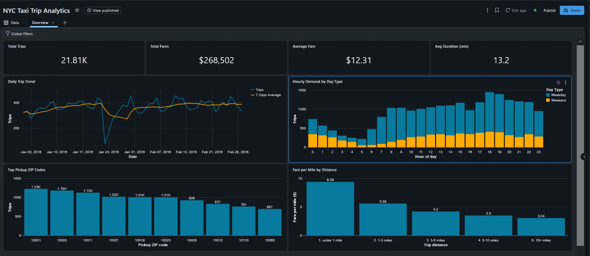
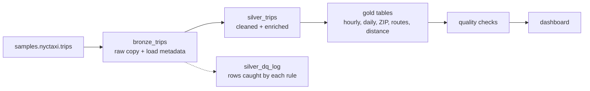
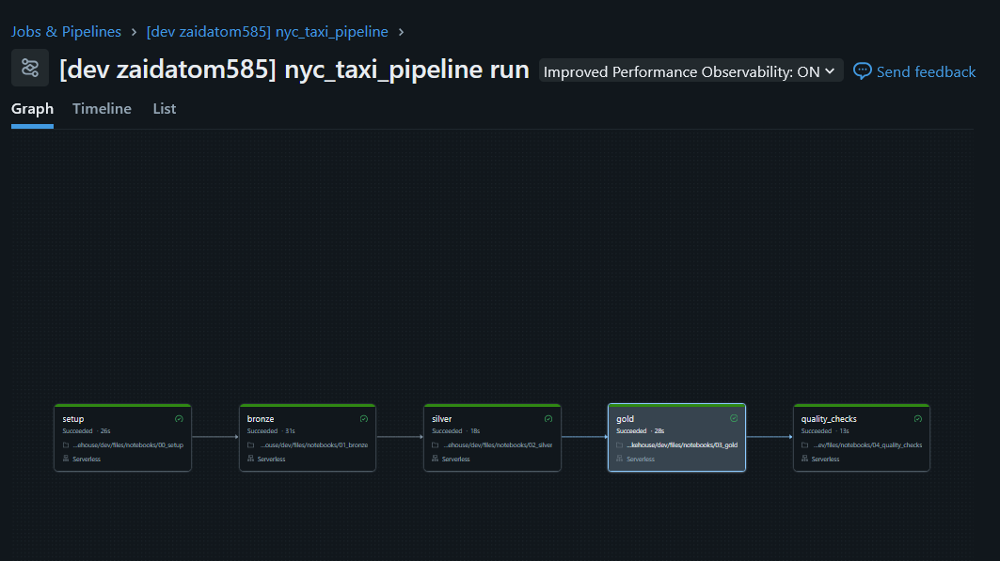
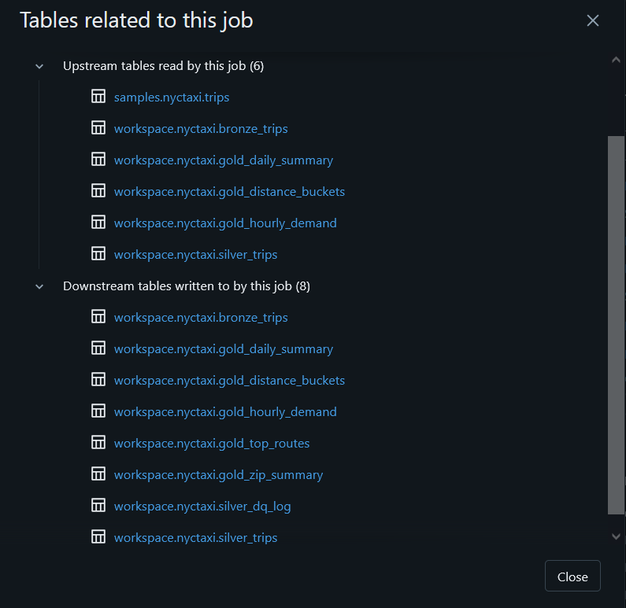

# NYC Taxi Lakehouse on Databricks

A bronze → silver → gold data pipeline on Databricks that cleans NYC taxi trip data with documented quality rules, builds analysis tables with PySpark window functions, verifies its own output with automated checks, runs as a job deployed with Databricks Asset Bundles, and feeds a dashboard.

**Tech stack:** Databricks · PySpark · Spark SQL · Delta Lake · Unity Catalog · Databricks Asset Bundles · Jobs · AI/BI Dashboards



## Architecture



| Layer | Table | Purpose |
|---|---|---|
| Bronze | `bronze_trips` | Unchanged copy of the source, plus load time and source name |
| Silver | `silver_trips` | Invalid trips removed; duration, speed, fare per mile, and time features added |
| Silver | `silver_dq_log` | How many rows each cleaning rule caught, on every run |
| Gold | `gold_hourly_demand` | Trips, fares, duration, and speed by hour, weekday vs. weekend |
| Gold | `gold_daily_summary` | Daily trips with a 7-day rolling average and day-over-day change |
| Gold | `gold_zip_summary` | Pickup ZIP codes ranked by trips |
| Gold | `gold_top_routes` | Most common pickup-to-dropoff routes |
| Gold | `gold_distance_buckets` | Fare per mile by trip length |

## The Pipeline as a Job

The pipeline is defined as code in `databricks.yml` and deployed with Databricks Asset Bundles. Each notebook runs as a task on serverless compute, in order, and the job stops at the first failure.



Unity Catalog tracks the job's lineage automatically: it reads the source sample table and writes all eight project tables.



## Data Cleaning Rules

A trip is removed if any of these are true: a required value is missing, distance or fare is zero or negative, dropoff is not after pickup, the trip lasts over 3 hours, or it covers over 100 miles. Each run logs how many rows every rule caught to `silver_dq_log`.

## Automated Quality Checks

`04_quality_checks.py` runs after every pipeline run and fails the job if any check fails, for example if a negative fare reaches the silver table, or if the gold tables don't account for every cleaned trip. All 9 checks pass on the current data.

## Key Findings

The pipeline processed 21,932 taxi trips from January 1 to February 29, 2016.

- **Data quality:** 118 trips (0.54%) failed the cleaning rules: 76 had zero distance, 33 lasted over three hours, 10 had a zero or negative fare, and 1 ended before it started (two trips broke more than one rule). 21,814 trips remain for analysis.
- **A blizzard in the data:** demand averaged 364 trips per day, but January 23, 2016 had just 78, about a fifth of normal. That was the day of the Winter Storm Jonas blizzard, when New York City imposed a travel ban. The busiest day was February 11, with 455 trips.
- **Evening peak, every day of the week:** weekday demand peaks at 6 PM (1,039 trips), 7 PM (1,001), and 9 PM (934); weekend demand also peaks at 6 PM (409) and 7 PM (394), with 5 PM (379) third. Weekend totals are lower mainly because the period has 18 weekend days versus 42 weekdays: per day, the 6 PM peak is about 23 trips on weekends versus 25 on weekdays.
- **Slowest traffic:** average speeds are lowest at 11 AM and 3 PM (10.5 mph) and 8 AM (10.9 mph).
- **Busiest pickup areas:** ZIP codes 10001 (1,225 trips), 10003 (1,180), and 10011 (1,126), covering Midtown West around Penn Station, Union Square and the East Village, and Chelsea. Trips from these areas average about 2.2 miles and $10.60 to $11.
- **Short trips cost three times more per mile:** fares fall steadily with distance, from $9.39 per mile for trips under one mile to $3.04 for trips over ten miles. Every trip includes a fixed starting charge that weighs more heavily on short trips, and longer trips spend less time crawling through city traffic.

| Trip length | Trips | Avg. fare | Fare per mile | Avg. speed |
|---|---|---|---|---|
| Under 1 mile | 5,299 | $5.44 | $9.39 | 9.2 mph |
| 1–3 miles | 10,825 | $9.40 | $5.59 | 11.2 mph |
| 3–5 miles | 2,697 | $15.81 | $4.20 | 15.9 mph |
| 5–10 miles | 1,869 | $24.14 | $3.50 | 33.3 mph |
| 10+ miles | 1,124 | $44.57 | $3.04 | 31.4 mph |

All results are exported to [`results/`](results) as CSV files.

## Limitations and Next Steps

- **Two months of data:** results describe January and February 2016 only, including a major blizzard, so seasonal patterns can't be compared.
- **Speed outliers:** average speeds are calculated per trip, so a few trips with very short recorded durations can inflate them. The 30+ mph averages for longer trips are plausible for highway and airport runs, but a next step is to add a maximum-speed rule to the silver layer and report median speeds alongside averages.
- **ZIP codes, not neighborhoods:** pickup locations are ZIP codes, which group large areas; joining to official taxi zone or neighborhood boundaries would give finer detail.

## How to Run

1. Clone this repo and open it in VS Code with the Databricks extension, connected to a workspace (serverless compute works).
2. Deploy the bundle and run the `nyc_taxi_pipeline` job from the extension's Bundle Resource Explorer (or with `databricks bundle deploy` and `databricks bundle run nyc_taxi_pipeline`).
3. Explore the results with `notebooks/05_analysis.py`, and build the dashboard from `sql/dashboard_queries.sql` (one query per dataset).
4. Export the results to `results/` as CSV files: set the `DATABRICKS_TOKEN` environment variable, then run `uv run --with databricks-sql-connector python scripts/export_results.py`.

The source data is the `samples.nyctaxi.trips` table included in every Databricks workspace, so no downloads are needed.

## Repository Structure

```
├── databricks.yml              # bundle config: the pipeline as a job
├── notebooks/
│   ├── 00_setup.py             # creates the schema
│   ├── 01_bronze.py            # raw ingestion
│   ├── 02_silver.py            # cleaning rules + data quality log
│   ├── 03_gold.py              # aggregate tables with window functions
│   ├── 04_quality_checks.py    # automated validation
│   └── 05_analysis.py          # questions and findings
├── scripts/export_results.py   # saves query results as CSV files
├── sql/
│   ├── dashboard_queries.sql   # dashboard datasets
│   └── results_snapshot.sql    # queries behind the key findings
├── results/                    # exported CSV results
└── images/                     # dashboard, job run, and lineage screenshots
```
